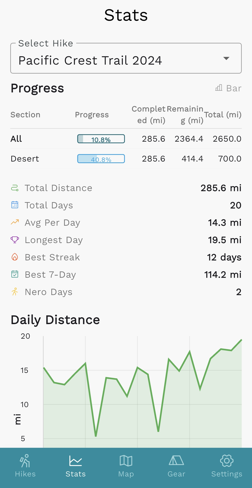

# Thru-Hike Tracker

Thru-Hike Tracker is an app designed to allow thru-hikers to track their hikes, view statistics based on daily mileage entries, keep a journal, and update friends and family along the way. Existing hike-tracking apps do not allow users to keep track of on-trail vs off-trail miles, alternate routes, or skips, but Thru-Hike Tracker will allow users to accurately document their hike even when things don't go as planned.

## Features
- Log entries for multiple long-distance hiking trails all in one place
- Track of present and custom fields such as daily mileage, elevation gain, number of wildlife sightings, gear used, etc., and view summary statistics for one or all trails
- Designate subsections of the trail, alternate routes, skipped sections, or side quests to more accurately keep track of distance
- Keep a gear log to track distances on shoes, packs, or any gear items used on one or multiple trails
- Option to add coordinates to daily entries to view all entries on a map

\
Example Summary Statistics Page:

